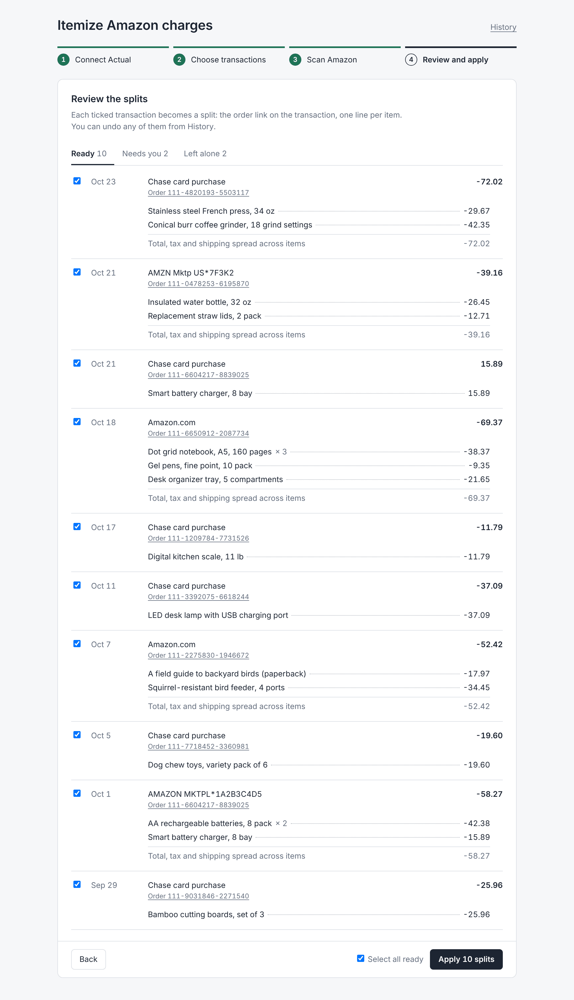
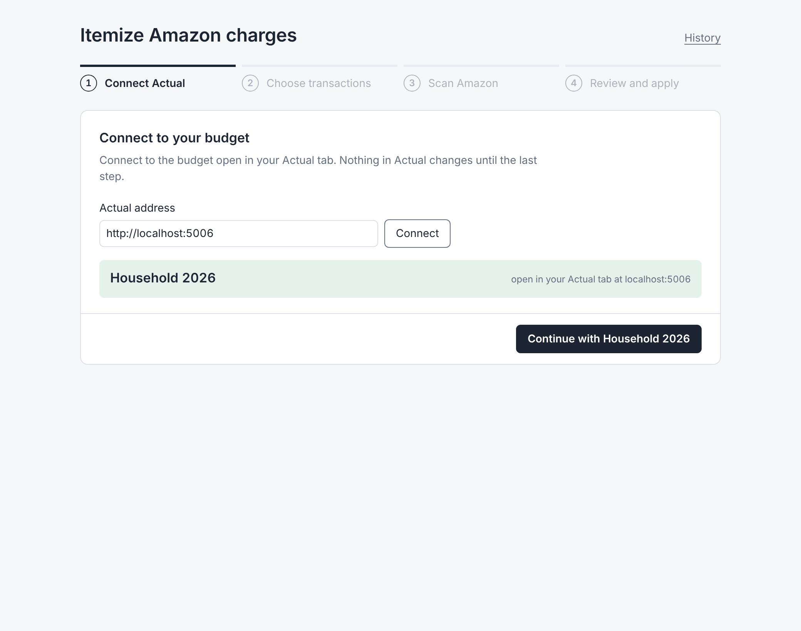
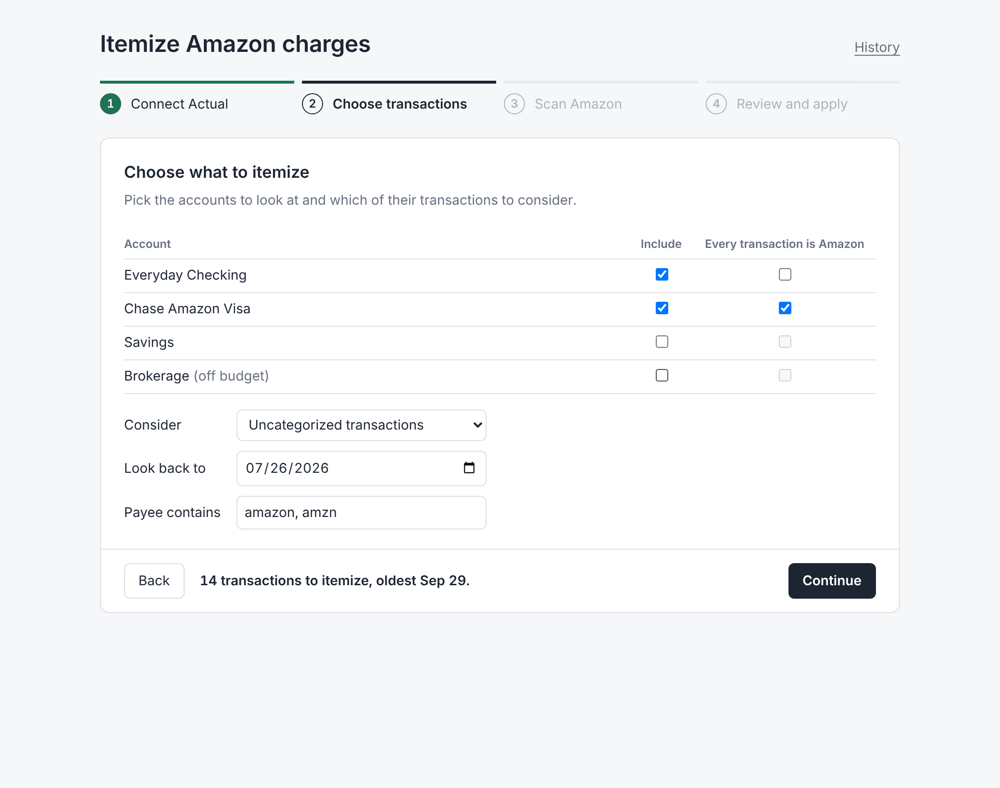
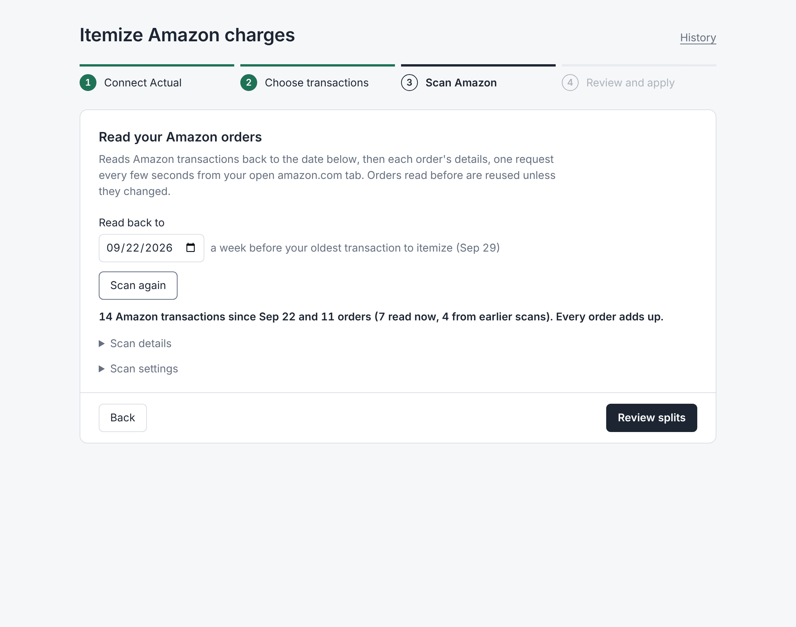
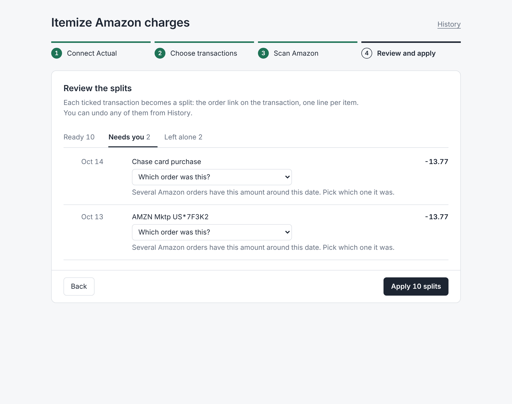

# Actual Budget Hydrator

A Firefox and Chrome extension that turns Amazon charges in [Actual Budget](https://actualbudget.org/)
into itemized splits: one line per item, with tax, shipping and discounts spread across the items so
the lines add up exactly to what your bank charged.

It runs in your own browser, using the Amazon and Actual tabs you already have open. No servers, no
passwords, no Amazon API.

<picture>
  <source media="(prefers-color-scheme: dark)" srcset="docs/screenshots/review-dark.png">
  
</picture>

## What it does

1. **Connect Actual.** Connect to the budget open in your Actual tab. The page shows which budget it is,
   and checks again before anything is written.
2. **Choose transactions.** Pick the accounts to look at and which transactions to consider
   (uncategorized, uncleared, either, or everything not yet itemized). Mark an Amazon store card as
   "every transaction is Amazon" so its transactions are considered whatever the payee says.
3. **Scan Amazon.** Reads your Amazon transaction history back to a week before the oldest transaction
   to itemize, then each order's details page. One request every 2.5-5 seconds, from your signed-in
   amazon.com tab. Orders read in an earlier scan are reused unless they changed.
4. **Review and apply.** Each candidate shows what it will become. Ticked ones are written to Actual as
   splits: the order link in the transaction's notes, one line per item with the item's title. Every
   apply can be reverted from History.

| | |
|---|---|
|  |  |
|  |  |

Screenshots use made-up data.

## Install

Download the latest build from [Releases](../../releases).

- **Firefox:** if the release has an `.xpi`, open it in Firefox to install. Otherwise unzip the
  `-firefox.zip`, go to `about:debugging#/runtime/this-firefox`, choose **Load Temporary Add-on** and
  pick `manifest.json` (temporary add-ons are removed when Firefox restarts).
- **Chrome:** unzip the `-chrome.zip`, go to `chrome://extensions`, turn on **Developer mode**,
  choose **Load unpacked** and pick the unzipped folder.

Then open your budget in one tab and any amazon.com page (signed in) in another, and click the
extension's toolbar button.

## What it reads and writes

- **Amazon:** reads your transactions page, the same data request that page makes when you scroll, and
  order details pages, in your session, from your amazon.com tab. It never places orders or changes
  anything on Amazon. It stops at the first sign-in page, CAPTCHA or error instead of retrying.
- **Actual:** reads accounts and transactions through Actual's own in-page API, in the tab you connect.
  It writes only when you click Apply, and only to the transactions you ticked: it re-reads each one
  first and skips it if it changed. It doesn't change dates, amounts, payees, accounts, or cleared and
  reconciled status. The transaction's category moves to its item lines.
- **Stored in the extension:** your settings, the last scan, parsed orders (so repeat scans are quick),
  and the list of applies for Revert. Nothing is sent anywhere else.

Try it on a copy of your budget first (Actual: File, Duplicate Budget). The page shows which budget is
connected and refuses to apply or revert if a different one is open.

## Limits

- amazon.com (US) only.
- Whole Foods in-store purchases aren't itemized: Amazon's transaction list doesn't link them to an order.
- Accounts on Amazon's older transactions page layout aren't supported.
- When two orders have the same amount around the same date, you pick which one it was. When a refund
  could be for either of two same-priced items, it's left for you to itemize by hand.

## Development

```
cd extension
npm install
npm test             # unit tests, including parity with amazon-orders' parser
npm run typecheck
npm run dev          # Firefox with live reload; npm run dev:chrome for Chrome
npm run build        # .output/firefox-mv2/
npm run build:chrome # .output/chrome-mv3/
npm run e2e          # drives the Chrome build end to end in Chromium
```

`npm run e2e` loads `.output/chrome-mv3` into Playwright's Chromium against a fake amazon.com (the
amazon-orders fixtures) and a fake Actual (`extension/e2e/fake-actual.html`), then connects, scans with
pagination, applies, reverts and checks budget switching. It runs twice: the second time without the
declared content script, as in a Chrome tab opened before the extension was loaded. It needs
`npm i -D playwright && npx playwright install chromium` once; screenshots land in `extension/e2e/.shots/`.

Amazon parsing is a TypeScript port of [amazon-orders](https://github.com/alexdlaird/amazon-orders).
`extension/tests/upstream-golden.test.ts` checks it field by field against amazon-orders' own output on
its test pages; see `extension/tests/fixtures/amazon-orders/README.md` to regenerate after syncing.

**Releases:** bump `version` in `extension/package.json`, commit, then push a matching tag
(`git tag v0.1.0 && git push origin v0.1.0`). The release workflow tests, builds both browsers and
attaches them to a GitHub Release. To also get a signed Firefox `.xpi`, add `AMO_JWT_ISSUER` and
`AMO_JWT_SECRET` repository secrets from your
[addons.mozilla.org API keys](https://addons.mozilla.org/developers/addon/api/key/); Mozilla signs it as
an unlisted add-on, which isn't published on the add-ons site.

`cli/` holds the earlier Python command-line version, which talks to an Actual server directly and logs
in to Amazon through amazon-orders.

## Credits

- [amazon-orders](https://github.com/alexdlaird/amazon-orders) by Alex Laird (MIT): the Amazon page
  parsing this ports, and its test pages.
- [actual-budget-tweaks](https://github.com/aelxxs/actual-budget-tweaks) (MIT): the technique for
  calling Actual's in-page API from an extension.

Not affiliated with Amazon or Actual Budget.

## License

MIT, see [LICENSE](LICENSE).
